<!--
  ARROW—GHOST · the profile of Shrish Verma
  Every graphic on this page is a hand-generated, self-contained SVG — see /scripts.
  No third-party stat cards. Telemetry refreshes itself via GitHub Actions.
  If you're reading the source: hi. Respect.
-->

  

  
  &nbsp;
  
  &nbsp;
  





<a href="https://github.com/Arrow-Ghost/Vidi"></a>

<a href="https://github.com/Arrow-Ghost/Vidi"><b>◆ source</b> · Arrow-Ghost/Vidi</a>

<a href="https://shadow-adj-frontend.vercel.app"></a>

<a href="https://shadow-adj-frontend.vercel.app"><b>▶ live</b> · shadow-adj-frontend.vercel.app</a> &nbsp;&nbsp;│&nbsp;&nbsp; <a href="https://github.com/Arrow-Ghost/ShadowAdj"><b>◆ source</b> · Arrow-Ghost/ShadowAdj</a>

<a href="https://2-d-quantum-maze.vercel.app"></a>

<a href="https://2-d-quantum-maze.vercel.app"><b>▶ live</b> · 2-d-quantum-maze.vercel.app</a> &nbsp;&nbsp;│&nbsp;&nbsp; <a href="https://github.com/Arrow-Ghost/2D-Quantum-Maze"><b>◆ source</b> · Arrow-Ghost/2D-Quantum-Maze</a>

<a href="https://github.com/Arrow-Ghost/PhishGuard1.0"></a>

<a href="https://github.com/Arrow-Ghost/PhishGuard1.0"><b>◆ source</b> · Arrow-Ghost/PhishGuard1.0</a>

<a href="https://kaledo-eta.vercel.app"></a>

<a href="https://kaledo-eta.vercel.app"><b>▶ live</b> · kaledo-eta.vercel.app</a> &nbsp;&nbsp;│&nbsp;&nbsp; <a href="https://github.com/Arrow-Ghost/Kaledo"><b>◆ source</b> · Arrow-Ghost/Kaledo</a>

<a href="https://nosql-jade.vercel.app">N quorum lab, and a live quiz scored server-side on Express + MongoDB Atlas. Stack: TypeScript, Three.js, WebGL, Express, MongoDB Atlas."/></a>

<a href="https://nosql-jade.vercel.app"><b>▶ live</b> · nosql-jade.vercel.app</a> &nbsp;&nbsp;│&nbsp;&nbsp; <a href="https://github.com/Arrow-Ghost/nosql"><b>◆ source</b> · Arrow-Ghost/nosql</a>


  <a href="https://github.com/Arrow-Ghost/Jeevika.."></a>
  <a href="https://github.com/Arrow-Ghost/Quantum-Tic-Tac-Toe-Gui-Version"></a>

  <a href="https://github.com/Arrow-Ghost/Quantum-Snake-Game"></a>
  <a href="https://github.com/Arrow-Ghost/p2p-comm-app"></a>

  <a href="https://github.com/Arrow-Ghost/solid-funicular"></a>
  <a href="https://github.com/Arrow-Ghost/ChatPal2.0"></a>

  <a href="https://github.com/Arrow-Ghost/ffcs-simulator-fall2026-27"></a>
  <a href="https://github.com/Arrow-Ghost/Smart-Irrigation-System"></a>

  <a href="https://github.com/Arrow-Ghost/Offline-notes"></a>




every pixel above is a hand-built SVG generated by <a href="./scripts">/scripts</a> · fonts: Source Sans / Source Code (SIL OFL)

